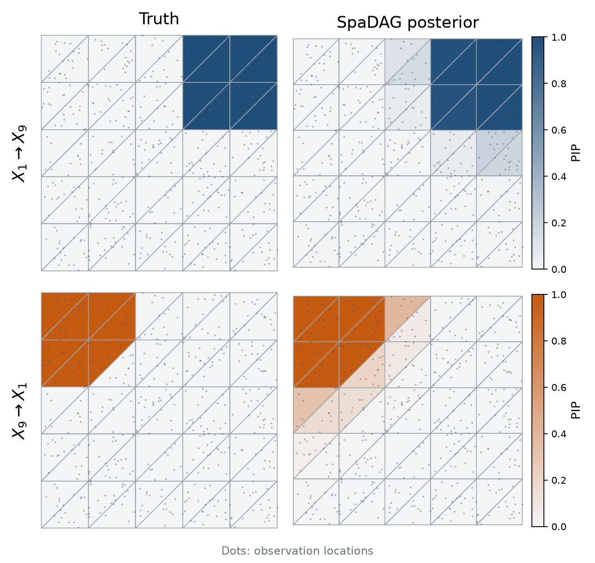

# SpaDAG

SpaDAG takes an `(n, p)` data matrix and the `(n, 2)` spatial coordinates of
its rows, and returns the posterior probability of every directed edge in
every triangle of a mesh over the domain.

SpaDAG is the method proposed in *Bayesian Learning of Spatially Heterogeneous Causal
Structure for Spatial Omics*. It infers the presence and orientation of
each causal edge among p variables at every location of a two-dimensional
domain. Local graphs live on a triangulation of the domain; each is acyclic,
but no ordering is shared across the domain, so a pair can point one way in
one region and the other way elsewhere. A spatial inclusion prior shares
information about each edge across nearby locations, a component-reversal
move lets the sampler flip an edge over a whole region in one step, and
triangle-level posterior inclusion probabilities (PIPs) summarize the support
for each direction.


(A) Observations on a triangulated domain, shaded by the inclusion propensity
of u → v (blue) and v → u (orange); the insets show the local DAGs on two
triangles. (B) A shared field and direction-specific fields give the inclusion
propensities, and the vertex indicators determine each local DAG through the
OR rule. (C) The sampler combines single-site updates with the reversal of an
edge over a maximal connected component; PIPs average the retained draws.

## Installation

SpaDAG requires Python 3.10 or newer, NumPy, SciPy, an `Rscript` executable,
and the R package `BayesLogit`, which draws the Pólya–Gamma variables of the
inclusion update exactly.

```bash
git clone https://github.com/KyungWookBack/SpaDAG.git
cd SpaDAG
python -m pip install .
Rscript -e 'dir.create(path.expand("~/Rlibs"), showWarnings=FALSE); install.packages("BayesLogit", lib=path.expand("~/Rlibs"))'
```

Preparing a bundle from your own observations additionally needs the
`prepare` extra and the R package `BayesGPfit`:

```bash
python -m pip install '.[prepare]'
Rscript -e 'dir.create(path.expand("~/Rlibs"), showWarnings=FALSE); install.packages("BayesGPfit", lib=path.expand("~/Rlibs"))'
```

`Rscript` is searched for on `PATH`, under `R_HOME`, and in the default
Windows installation directory; the R packages are looked up in `~/Rlibs` and
then in the usual R library paths.

## Quickstart

The repository bundles one example dataset,
[`artifacts/data/example_reversal_p50_n500`](artifacts/data/example_reversal_p50_n500):
a regional-reversal simulation with n = 500 observations, p = 50 variables and
a regular mesh with 36 vertices and 50 triangles, taken from the manuscript's
simulation cohort. From the repository root, run a short smoke check of twenty
sweeps (about a minute):

```bash
spadag \
  --data artifacts/data/example_reversal_p50_n500 \
  --trace-dir runs/smoke/trace \
  --iters 20 --burn 10 --seed 1
```

The posterior summaries are written to `runs/smoke/trace/summary.npz`:

```bash
python -c "import numpy as np; r=np.load('runs/smoke/trace/summary.npz', allow_pickle=False); print('edge_prob', r['edge_prob'].shape); print('gamma_prob', r['gamma_prob'].shape); print('kept', int(r['kept'])); r.close()"
```

`edge_prob[t, j, k]` is the posterior probability of the edge k → j in
triangle `t`, so its shape is `(50, 50, 50)` here; `gamma_prob` holds the
nodal indicator probabilities with shape `(50, 50, 36)`. Because the example
comes with simulation truth, recovery can be scored:

```bash
spadag-evaluate \
  --result runs/smoke/trace/summary.npz \
  --data artifacts/data/example_reversal_p50_n500 \
  --truth artifacts/data/example_reversal_p50_n500 \
  --out runs/smoke/recovery.json
```

This reports TPR, FDR and F1 of the edges with PIP at least 0.5 against the
true triangle graphs. With two retained sweeps these numbers only show that
the pipeline runs; a chain for inference uses the default protocol of
[docs/usage.md](docs/usage.md), which is the manuscript's setting of 50,000
sweeps with a burn-in of 25,000:

```bash
spadag \
  --data artifacts/data/example_reversal_p50_n500 \
  --trace-dir runs/chain1/trace \
  --checkpoint runs/chain1/checkpoint.pkl \
  --seed 1
```

## Example results



One of the twenty reversal pairs of the example dataset. In the truth
(left), X1 → X9 holds in one region and X9 → X1 in another. The SpaDAG
posterior (right) is the manuscript's 50,000-sweep chain for this dataset; the
PIP of each direction concentrates on its own region, and over all
triangle–edge pairs the chain reaches TPR 0.81, FDR 0.15 and F1 0.83 at
PIP ≥ 0.5. The figure is drawn by
[docs/plot_example_recovery.py](docs/plot_example_recovery.py) from any
`summary.npz` of the example bundle.

## Working model of the sampler

The structural model of the manuscript places a point mass at zero on
inactive coefficients, and its identifiability result concerns that
population model. To keep the coefficient updates Gaussian, the sampler
replaces the point mass with a Gaussian spike of fixed variance `--v0`
(default `1e-3`) and targets the corresponding working posterior; the local
graphs are still defined by the indicators, so every sampled triangle graph is
acyclic. See [docs/usage.md](docs/usage.md#working-model-of-the-sampler).

## Documentation

- [docs/usage.md](docs/usage.md): the default protocol and its options,
  checkpoints and resuming, multi-chain diagnostics, and preparing a bundle
  from your own observations and locations.
- [docs/data-format.md](docs/data-format.md): the five-array inference bundle,
  the simulation-truth files, and the example dataset.
- [docs/reproducibility.md](docs/reproducibility.md): the simulation
  generator and cohort seeds, checkpoint compatibility, and the software
  versions used for the manuscript.
- `spadag --help`, `spadag-prepare --help`, `spadag-evaluate --help`,
  `spadag-diagnose --help`, `spadag-generate-reversal --help`.

## Citation

A preprint describing the method is in preparation. Citation details and a
`CITATION.cff` file will be added here when it is available.

## License

SpaDAG is released under the MIT License. See [`LICENSE`](LICENSE).
