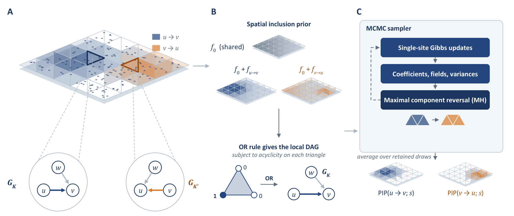

# SpaDAG

SpaDAG takes an `(n, p)` data matrix and the `(n, 2)` spatial coordinates of
its rows, and returns the posterior probability of every directed edge in
every triangle of a mesh over the domain.

SpaDAG is the method proposed in *Bayesian Spatially Heterogeneous Causal
Discovery for Spatial Omics Data*. It infers the presence and orientation of
each causal edge among p variables at every location of a two-dimensional
domain. Local graphs and structural-coefficient
surfaces are represented on a common triangulation of the domain; each local
graph is acyclic, but no topological ordering is shared across the domain, so
opposite orientations of a pair can be supported in different regions. A
spatial inclusion prior models the inclusion propensity of each candidate
direction as a spatial field with a component shared by all directions and a
direction-specific component, both represented by truncated Karhunen–Loève
expansions, so that information about edge presence is shared across nearby
locations while each edge keeps its own region of support. The posterior
sampler includes a component-reversal move that reverses an edge jointly over a
connected region of support in a single step, and draws the Pólya–Gamma
variables of the inclusion update exactly through the R package `BayesLogit`.
Triangle-level posterior inclusion probabilities summarize the support for each
direction at each location.



(A) Observations on a triangulated domain, shaded by the inclusion propensity
of u → v (blue) and v → u (orange); the insets show the local DAGs on two
triangles. (B) A shared field and direction-specific fields give the inclusion
propensities, and the vertex indicators determine each local DAG through the
OR rule. (C) The sampler combines single-site updates with the reversal of an
edge over a maximal connected component; PIPs average the retained draws.

This repository contains the `spadag` Python package: the sampler, bundle
preparation from raw observations and locations, simulation-recovery
evaluation, multi-chain diagnostics, and the simulation generator of the
manuscript. The command-line defaults are the settings of the manuscript's
simulation studies and data analysis.

## Installation

SpaDAG requires Python 3.10 or newer, NumPy, SciPy, an `Rscript` executable,
and the R package `BayesLogit`. Preparing a new inference bundle from raw
observations and locations additionally uses Matplotlib, `contourpy`, the
Python `triangle` package, and the R package `BayesGPfit`.

```bash
git clone https://github.com/KyungWookBack/SpaDAG.git
cd SpaDAG
python -m pip install .
Rscript -e 'dir.create(path.expand("~/Rlibs"), showWarnings=FALSE); install.packages("BayesLogit", lib=path.expand("~/Rlibs"))'
```

Install the preparation dependencies when you need `spadag-prepare` or the
simulation generator:

```bash
python -m pip install '.[prepare]'
Rscript -e 'dir.create(path.expand("~/Rlibs"), showWarnings=FALSE); install.packages("BayesGPfit", lib=path.expand("~/Rlibs"))'
```

`Rscript` is searched for on `PATH`, under `R_HOME`, and in the default
Windows installation directory. The R packages are looked up in `~/Rlibs` and
then in the usual R library paths. The other extras are `.[diagnostics]`
(ArviZ and psutil for `spadag-diagnose`) and `.[test]` (pytest).

## Quickstart with the example dataset

The repository bundles one small example dataset,
[`artifacts/data/example_reversal_p50_n500`](artifacts/data/example_reversal_p50_n500)
(about 1.4 MB): a regional-reversal simulation with n = 500 observations,
p = 50 variables, a regular mesh with H = 36 vertices and T = 50 triangles, and
an L = 66 K–L design. It is replicate 1 of the `P50_N500_S1` cell of the
manuscript's simulation cohort, and `metadata.json` records how to regenerate
it. The true triangle graphs (`edge_triangle.npy`) are read only by
`spadag-evaluate`.

From the repository root, run a short smoke check of twenty sweeps:

```bash
spadag \
  --data artifacts/data/example_reversal_p50_n500 \
  --trace-dir runs/smoke/trace \
  --iters 20 --burn 10 --seed 1
```

The run takes about a minute. It prints the sampler settings and a summary line, and writes the chain's
traces to `--trace-dir`. The posterior summaries are in `summary.npz` inside
that directory; `--out` additionally writes a copy to a path of your choice.
A minimal inspection step is:

```bash
python -c "import numpy as np; r=np.load('runs/smoke/trace/summary.npz', allow_pickle=False); print('edge_prob', r['edge_prob'].shape); print('gamma_prob', r['gamma_prob'].shape); print('kept', int(r['kept'])); r.close()"
```

which prints

```
edge_prob (50, 50, 50)
gamma_prob (50, 50, 36)
kept 2
```

`edge_prob` has shape `(T, p, p)` and holds the posterior inclusion
probability of each directed edge in each triangle, `edge_prob[t, j, k]` for
the edge k → j. `gamma_prob` has shape `(p, p, H)` and holds the nodal
indicator probabilities. `kept` is the number of retained post-burn-in sweeps
behind these summaries: two here, because sweeps 11 to 20 are thinned by five.
The ten triangle–edge pairs with the highest posterior probability are listed
by

```bash
python - <<'EOF'
import numpy as np
r = np.load("runs/smoke/trace/summary.npz", allow_pickle=False)
prob = r["edge_prob"]
t, j, k = np.unravel_index(np.argsort(prob, axis=None)[::-1][:10], prob.shape)
for row in zip(t, k, j, prob[t, j, k]):
    print("triangle %d: %d -> %d  PIP %.3f" % row)
EOF
```

Because the example comes with simulation truth, recovery can be scored:

```bash
spadag-evaluate \
  --result runs/smoke/trace/summary.npz \
  --data artifacts/data/example_reversal_p50_n500 \
  --truth artifacts/data/example_reversal_p50_n500 \
  --out runs/smoke/recovery.json
```

This reports TPR, FDR and F1 of the edges with posterior probability at least
0.5 against the true triangle graphs, and the recovery of the reversal motifs
listed in `metadata.json`.

### Default protocol

The CLI defaults are the settings used throughout the manuscript: 50,000
sweeps per chain, of which the first 25,000 are discarded as burn-in and every
fifth subsequent state is retained for the posterior summaries (5,000 draws),
initialization at the empty graph, 50 maximal component-reversal attempts per
sweep, and the 66-term K–L expansion of the prepared bundle. The manuscript's
simulation results come from one chain per dataset, each with its own seed,
and its data analysis from four chains with distinct seeds. A full chain with
checkpoints is

```bash
spadag \
  --data artifacts/data/example_reversal_p50_n500 \
  --trace-dir runs/chain1/trace \
  --checkpoint runs/chain1/checkpoint.pkl \
  --seed 1
```

`--initialization prior-random` starts from Bernoulli(0.5) indicators
restricted to local DAGs, and `--m-rev 0` disables the reversal move, which
gives the ordinary Gibbs sampler with Pólya–Gamma inclusion updates. The prior
hyperparameters (`--v0`, `--a-b`, `--b-b`, `--a-tau`, `--b-tau`,
`--common-gp-var-prior`, `--mu-prior-mean`, `--mu-prior-sd`) and the trace
thinning intervals are listed by `spadag --help`.

A chain is extended by resuming its checkpoint with a larger `--iters`. The
other options, including `--seed`, must repeat those of the original run, since
the checkpoint records them and a different setting is refused:

```bash
spadag \
  --data artifacts/data/example_reversal_p50_n500 \
  --trace-dir runs/chain1/trace \
  --checkpoint runs/chain1/checkpoint.pkl \
  --resume runs/chain1/checkpoint.pkl \
  --seed 1 \
  --iters 60000
```

The trace directory stores online triangle PIP and coefficient moments, small
diagnostic streams and packed indicator states; retained draws are written to
append-only chunk files linked by SHA-256, so the checkpoint holds no draw
history. The trace directory and the checkpoint must be moved together.

### Multi-chain diagnostics

Run two or more chains with distinct seeds on the same bundle, then

```bash
spadag-diagnose runs/chain1/trace runs/chain2/trace \
  --truth artifacts/data/example_reversal_p50_n500 \
  --out runs/diagnostics.json
```

This computes rank-normalized split R-hat and bulk/tail ESS of the scalar
traces with ArviZ, and reports between-chain differences of the edge
probabilities. `--truth` is optional. Both
`spadag-evaluate` and `spadag-diagnose` take `--truth` as the directory that
holds `edge_triangle.npy`; `spadag-diagnose` also accepts the `.npy` file
itself.

## Use your own observations and locations

Most users provide only two files:

- `X.npy`: a finite observed-data matrix with shape `(n, p)` and `p > 1`;
- `obs_points.npy`: finite two-dimensional coordinates with shape `(n, 2)`.

Rows must align: row `i` in both files must describe the same observation.
`X` is the matrix that enters the Gaussian working likelihood, with each
column centered and scaled across observations; the default priors are set for
this scale, and neither `spadag-prepare` nor the sampler standardizes the
input. Count data need a variance-stabilizing transformation first, for
example the Pearson residuals used for the manuscript's tissue section. First
prepare a deterministic bundle, then run inference:

```bash
# 1. Triangulate the domain and prepare the inference bundle.
#    Defaults: observation-supported polygon mesh in the input coordinates and
#    the manuscript's K-L design (L = 66, max_range = 1, poly_degree = 10).
spadag-prepare \
  --x analysis/X.npy \
  --locations analysis/obs_points.npy \
  --outdir analysis/bundle \
  --target-tris 75 --min-obs-per-triangle 6 --max-obs-per-triangle 40

# 2. Run posterior inference on that fixed bundle.
spadag \
  --data analysis/bundle \
  --trace-dir analysis/chain1/trace \
  --checkpoint analysis/chain1/checkpoint.pkl \
  --seed 1
```

Preparation and inference are separate steps because the mesh and the K–L
design are analysis choices that determine checkpoint compatibility.
`spadag-prepare` records them in `preparation_manifest.json`, and `spadag`
reads only the resulting bundle.

The default preparation path is the one used for the manuscript's
tissue-section analysis: `--mesh-type polygon` meshes an observation-supported
polygon domain (concave hull with holes) in the input coordinates, optionally
bounding the observations per triangle with
`--min-obs-per-triangle`/`--max-obs-per-triangle`, and the K–L design is the
full degree-10 expansion (`--L 66 --max-range 1 --poly-degree 10`). `L` may
exceed the number of mesh vertices because the sampler keeps every coefficient
coordinate under its proper Gaussian prior. `--mesh-type regular` builds the
deterministic `5 x 5` triangulation and `--mesh-type cdt` a constrained
Delaunay triangulation over the observation bounding box; add
`--domain 0 1 0 1` to mesh the known unit-square domain instead, which
reproduces the simulation meshes. Advanced users may instead supply
`--mesh-points` and `--mesh-triangles` for an arbitrary triangulation, and
`--a-kl` for an existing K–L design. See `spadag-prepare --help` for the
complete interface.

## Inference-bundle contract

The prepared schema-v1 bundle contains exactly five required NumPy arrays:

| File | Shape | Contract |
| --- | --- | --- |
| `X.npy` | `(n, p)` | finite observed variables |
| `Phi_obs.npy` | `(n, H)` | finite, nonnegative P1 weights; every row sums to one |
| `mesh_points.npy` | `(H, 2)` | finite 2D mesh coordinates |
| `mesh_triangles.npy` | `(T, 3)` | integer vertex indices in `[0, H)`; no degenerate triangles |
| `A_kl.npy` | `(H, L)` | finite K–L design with `L > 0` |

No manifest or simulation truth is required for inference. The loader reads
only these five files and rejects inconsistent dimensions, invalid geometry,
non-finite values, or unsupported dtypes. Simulation truth
(`edge_triangle.npy` with shape `(T, p, p)`, and the optional
`reversal_motifs` list in `metadata.json`) is a separate schema used only by
`spadag-evaluate`.

A bundle built with any other triangulation workflow can be passed to `spadag`
directly, as long as it contains these five arrays.

## Simulation generator

`spadag-generate-reversal` implements the data-generating mechanism of the
manuscript's regional-reversal simulation study: a regional-reversal graph
field on the regular 36-vertex mesh, `Uniform(0.5, 1.5)` coefficients, a
linear structural equation model with iid uniform locations on the unit
square, one global coefficient multiplier calibrated to a target median
population signal-to-noise ratio, and per-column standardization. The
manuscript's mesh-sensitivity study refits these datasets on other inference
meshes; its no-reversal study uses a different generator that is not part of
this package. The seeds of the 150-dataset reversal cohort (five cells
`P50_N500_S1`, `P25_N500_S1`, `P75_N500_S1`, `P50_N250_S1`, `P50_N1000_S1`,
30 replicates each) are tracked in
[`artifacts/data/reversal_cohort_seeds.json`](artifacts/data/reversal_cohort_seeds.json)
together with the SHA-256 of each dataset's `gamma.npy`, so any cohort dataset
can be regenerated without distributing the bundles:

```bash
spadag-generate-reversal --out runs/P25_N500_S1_rep001 --cohort-cell P25_N500_S1 --replicate 1 --no-kl
spadag-prepare --x runs/P25_N500_S1_rep001/bundle/X.npy --locations runs/P25_N500_S1_rep001/bundle/obs_points.npy \
  --outdir runs/P25_N500_S1_rep001/inference --mesh-type regular --domain 0 1 0 1
```

The `p = 50` cells share one set of `n = 1000` observations, and the `n = 500`
and `n = 250` datasets are re-standardized prefixes of it, which is why the
example bundle's `metadata.json` lists two generator commands. The background
patch sizes, coverage window and target edge density can be changed from the
command line; see `spadag-generate-reversal --help`.

Recovery on an inference mesh that differs from the generating mesh is
evaluated with `spadag-evaluate --eval-points sobol|observed|both`, which pools
location-wise true and false positives and false negatives and reports the
representational ceiling of the inference mesh.

## Integrity, checkpoints, and security

Use each bundle's `SHA256SUMS` file to verify the byte-level integrity of its
tracked files:

```bash
cd artifacts/data/example_reversal_p50_n500 && sha256sum -c SHA256SUMS
```

`--checkpoint` writes a versioned pickle containing the complete sampler and
Python/R RNG states. Compatibility is based on a SHA-256 fingerprint of the
five validated inference arrays, so an unchanged bundle can be moved between
directories or operating systems. A same-shaped bundle with different values
is rejected.

Pickle can execute code while loading, so resume only checkpoints that you
created or obtained from a trusted source.

## Reproducibility and support scope

Exact continuation from a checkpoint and byte-for-byte regeneration of the
cohort arrays are tested with Python 3.13.9, NumPy 2.5.4, SciPy 1.18.1,
R 4.5.2, `BayesLogit` 2.4 and `BayesGPfit` 1.1.0. A checkpoint records the
Python, NumPy and SciPy versions and the SHA-256 of the sampler modules, and
resuming it under different versions is refused. NumPy's random streams can
change between feature releases, so the generator's output for a given seed
is tied to the NumPy version. The sampler does not set the number of BLAS
threads; the manuscript's chains ran with one thread, and a run is repeated
bit for bit only with the same thread count, for example
`OMP_NUM_THREADS=1 OPENBLAS_NUM_THREADS=1 MKL_NUM_THREADS=1`.

The R packages are external system dependencies and are not installed by the
wheel. The tests run with

```bash
python -m pip install '.[test,prepare,diagnostics]'
pytest
```

## Citation

A preprint describing the method is in preparation. Citation details and a
`CITATION.cff` file will be added here when it is available.

## License

SpaDAG is released under the MIT License. See [`LICENSE`](LICENSE).
